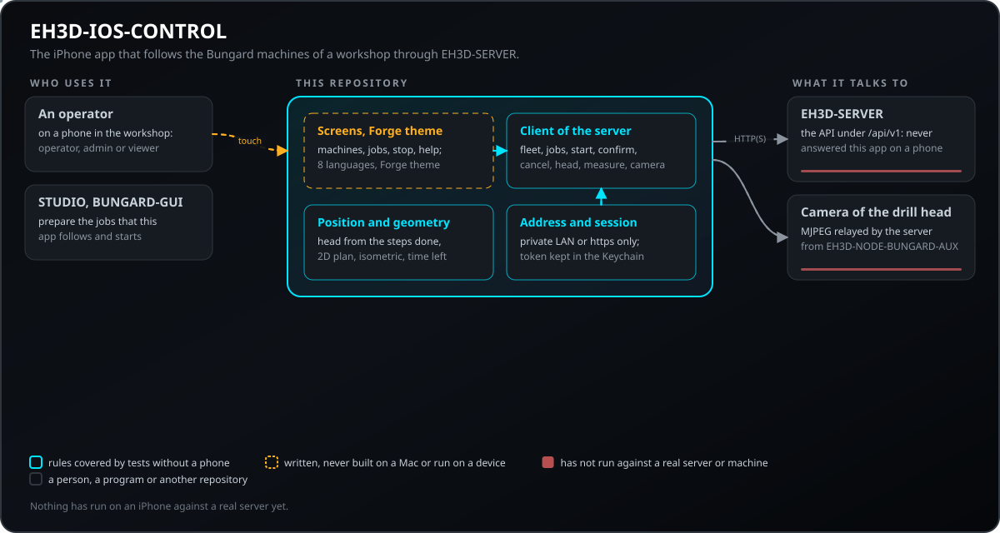
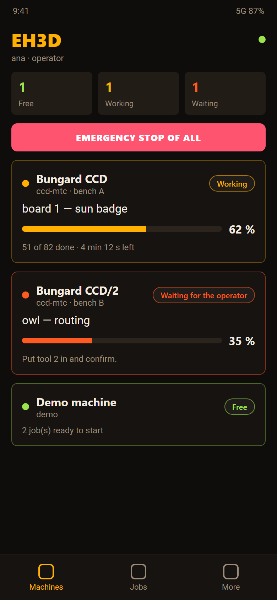
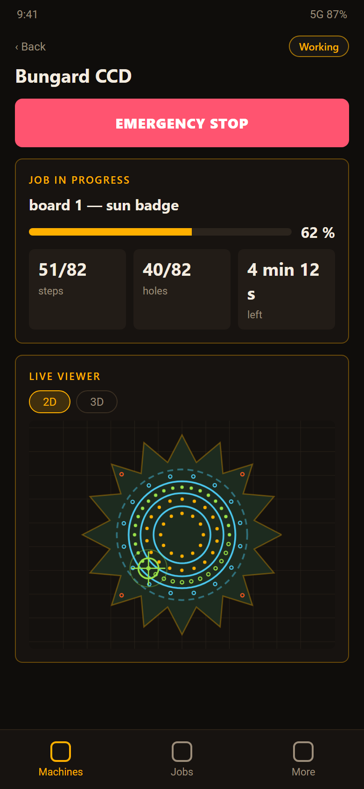
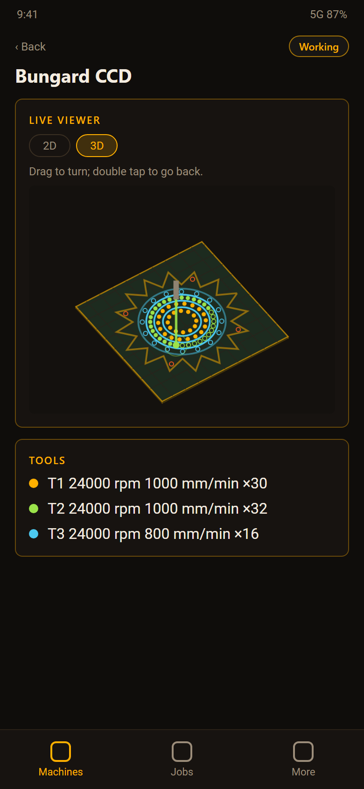
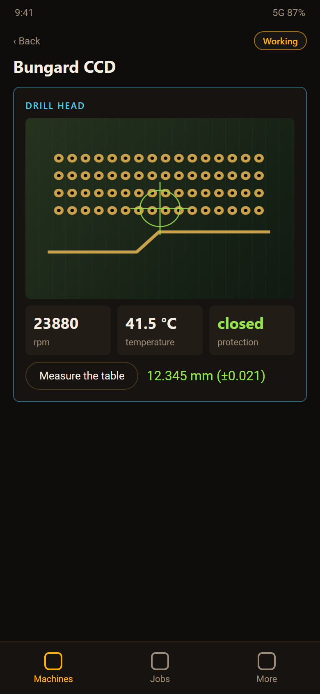
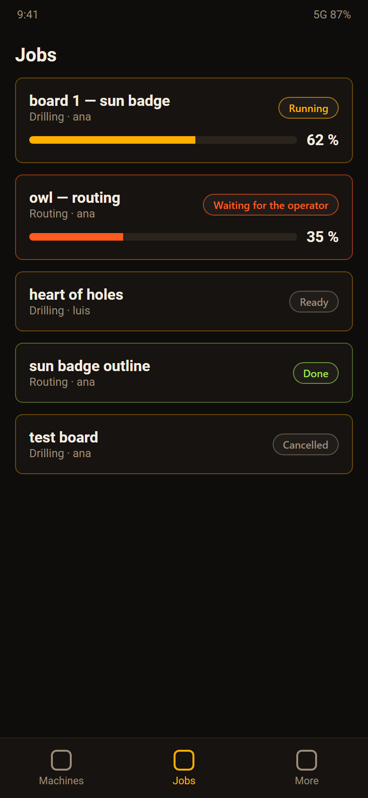
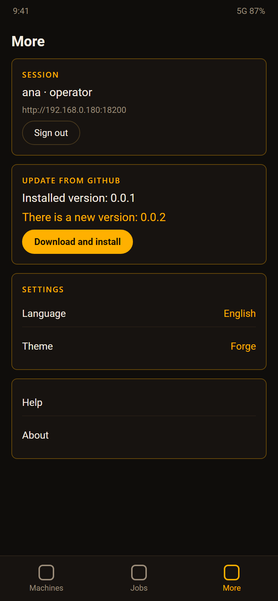
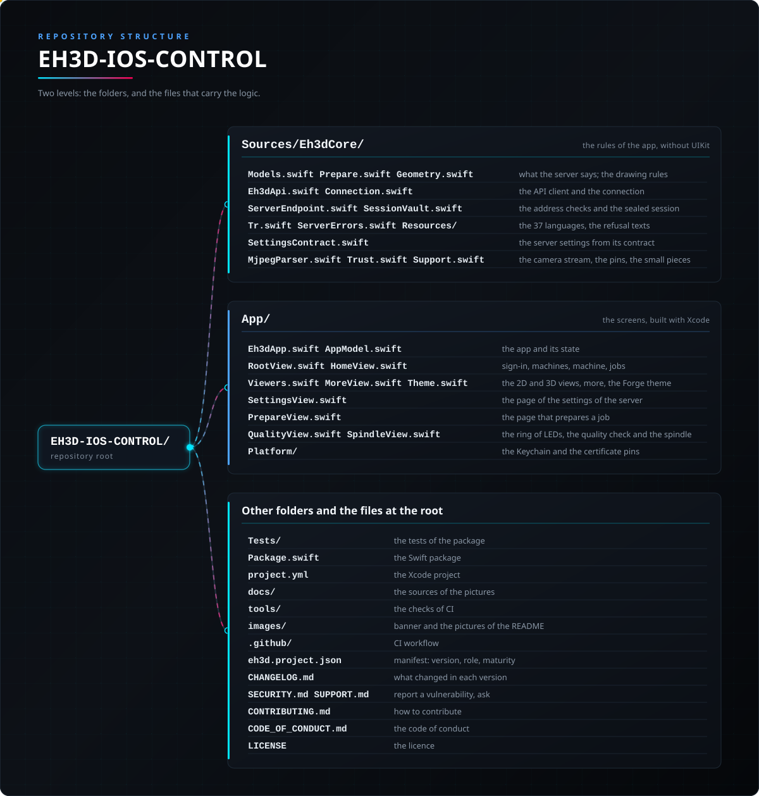

<p align="center">
  
</p>

# 🍎 EH3D-IOS-CONTROL

<p align="center"><a href="README.md">🇺🇸 English</a> | <a href="README_spa.md">🇪🇸 Español</a> | 🇫🇷 <b>Français</b> | <a href="README_ita.md">🇮🇹 Italiano</a> | <a href="README_deu.md">🇩🇪 Deutsch</a> | <a href="README_zho.md">🇨🇳 中文</a> | <a href="README_jpn.md">🇯🇵 日本語</a> | <a href="README_por.md">🇵🇹 Português</a></p>

### L'application iPhone des programmes EH3D : elle suit en temps réel les machines Bungard de l'atelier via EH3D-SERVER, les arrête, montre le travail en 2D et 3D et la caméra de la tête de perçage

<p align="center">
  
  
  
  
  
</p>

---

**Vérification d'honnêteté - ce qui tourne aujourd'hui :** les règles de l'application (lire ce que EH3D-SERVER dit des machines, des travaux et de la tête, la position de la tête à partir des étapes faites, la géométrie 2D et isométrique, les langues, les contrôles d'adresse et la conservation de la session) sont écrites et testées sur un ordinateur. Les écrans sont écrits pour iPhone dans le thème Forge des programmes EH3D, mais **l'application n'a pas été exécutée sur un iPhone contre un vrai serveur**, l'arrêt d'urgence n'a jamais arrêté une vraie machine et la caméra n'a jamais montré une vraie carte.

---

> **État de sécurité :** cette application n'est pas un système de sécurité et ne remplace pas l'arrêt d'urgence de la machine. Son arrêt annule le travail en cours via le serveur, qui arrête la machine et coupe les moteurs ; il faut que le réseau et le serveur fonctionnent. Seuls les opérateurs et les administrateurs peuvent arrêter ou démarrer ; le mot de passe n'est envoyé qu'à une adresse du réseau local ou en https, et la session est conservée chiffrée sur le téléphone.


## 📋 En un coup d'œil

| | |
|---|---|
| Version | `0.2.0` |
| Maturité | Échafaudage |
| Tests | 501 tests du paquet Swift |
| Pile technique | Swift, SwiftUI |
| Sur du matériel réel | Pas encore : l'application n'a pas été exécutée sur un iPhone, contre un vrai serveur ni avec une machine ; la première chose à essayer est de se connecter au EH3D-SERVER de l'atelier. |

**Aller à  :** [Présentation](#-présentation) · [Architecture](#-architecture) · [Démarrage rapide](#-démarrage-rapide) · [Tests](#-tests) · [Structure](#-structure-du-dépôt) · [Liés](#-projets-liés)

## 🚦 État du projet

Chaque ligne est une partie de ce dépôt et le feu dit où elle en est aujourd'hui. Elle est écrite d'après ce que le dépôt peut montrer (tests, compilations, exécutions), pas d'après ce qui est prévu.

🟢 Fait et vérifié · 🟡 Fonctionne, avec des limites connues · 🟠 À moitié fait ou pas encore vérifié · 🔴 Pas fait ou ne fonctionne pas

| Domaine | État | Ce que cela veut dire ici |
|---|---|---|
| Logiciel | 🟠 | Les écrans et les règles de l'application sont écrits pour iPhone ; les règles se compilent et se testent sans téléphone. |
| Tests | 🟡 | tests du paquet Swift : ce que dit le serveur de la flotte, des travaux et de la tête, la position de la tête, la géométrie 2D et isométrique, les langues et les contrôles d'adresse et de version. |
| Surveillance | 🟠 | Chaque machine de l'atelier avec son état, son travail, la progression, les étapes faites et le temps restant, lu depuis le serveur toutes les secondes et demie ; un avis quand une machine attend l'opérateur ou s'arrête. Écrit, non exécuté contre un vrai serveur. |
| Connexion | 🟠 | La session se renouvelle d'elle-même dans le dernier quart de sa durée de vie, les sessions ouvertes peuvent être listées et fermées, les refus du serveur sont dits en huit langues depuis la même table que Studio, et le délai d'attente, les nouvelles tentatives et une recherche facultative du serveur sur le réseau local (désactivée par défaut) sont des réglages. Écrit et testé contre un serveur simulé ; non exécuté contre un vrai serveur ni sur un iPhone. |
| Arrêt d'urgence | 🟠 | Un bouton rouge qui demande deux fois et annule le travail en cours via le serveur (une machine ou toutes) ; la confirmation des étapes qu'attend un travail. Seulement opérateurs et administrateurs. Il n'a jamais arrêté une vraie machine et ne remplace pas son arrêt physique. |
| Préparer des travaux | 🟠 | Choisir perçage, fraisage, les deux ou un programme G-code et le fichier du téléphone ; les outils du fichier avec leur nombre (et leur diamètre quand le fichier le déclare), désactiver des outils, commencer par l'un d'eux ; mettre en pause, reprendre, annuler et reprendre un travail arrêté (de tout type) là où il s'est arrêté, avec le fichier gardé par le serveur ; lire l'interrupteur des lignes `$` de GRBL de la machine. Le serveur n'a pas de liste de fichiers : le fichier est envoyé depuis le téléphone. Écrit, jamais exécuté contre un vrai serveur ni une vraie machine. |
| Visionneuse 2D et 3D | 🟠 | La carte, les trous (un anneau jusqu'au perçage), les trajets (pâles jusqu'à la coupe) et la tête, en 2D et dans une vue isométrique qui tourne au doigt ; la position de la tête est une estimation à partir des étapes faites. Testé comme géométrie, jamais vu sur un téléphone. |
| Caméra de la tête | 🟠 | La caméra de la tête de perçage (EH3D-NODE-BUNGARD-AUX) en MJPEG via le serveur, sa vitesse, sa température et sa sortie de protection, et une mesure de la table au laser. Écrit, jamais exécuté avec un vrai nœud. |
| Mises à jour | 🟠 | Elle regarde la dernière release de ce projet sur GitHub et l'indique avec un lien ; une application iPhone ne peut pas se mettre à jour seule hors de l'App Store, la nouvelle version s'installe donc depuis la release comme la personne le choisit. |
| Machines des plugins | 🟠 | La page d'accueil liste les machines laser, pick-and-place, cartes, CNC, Gerber, FAO, imprimante 3D, vision et CAO du serveur avec un badge SIMULATEUR SEULEMENT (rien n'est présenté comme éprouvé sur du matériel), leurs verrouillages en rouge, un arrêt d'urgence d'une seule touche et sans question, la levée d'un verrouillage réservée aux administrateurs (demandée deux fois), la file de chaque machine (chaque travail montre un code court de son hachage avec un badge - non autorisé, autorisé ou expiré ; une personne l'autorise d'une seconde touche et le démarre, demandé deux fois, en envoyant le code montré ; jamais tout seul), les limites de température d'une imprimante et, pour un administrateur, les interrupteurs du serveur éteints par défaut. Écrit et testé contre un serveur simulé ; jamais exécuté sur un iPhone ni avec une machine réelle. |
| Réglages du serveur | 🟠 | Une page dans Plus dessine chaque réglage et interrupteur du serveur à partir de son contrat (107 clés en 17 groupes ; lu depuis le serveur et, si cela n'est pas possible, depuis la copie conservée dans l'application, en lecture seule) : libellé, aide et avertissement en huit langues, la valeur en vigueur, la valeur par défaut avec un bouton pour la rétablir, si le changement s'applique tout de suite ou demande un redémarrage, et le contrôle de son type. Tout autre compte (lecteur, opérateur) lit la vue légère des valeurs en vigueur (`GET /settings/values`, avec un ETag pour qu'une page inchangée ne coûte que quelques octets) avec les libellés de la copie, en lecture seule, et est prévenu lorsque la liste des réglages du serveur n'est pas la copie de l'application ; une clé que le serveur ne montre pas est signalée comme telle. Un administrateur modifie les 19 clés que le serveur change en marche et on lui demande une seconde fois pour une clé à risque ; les 81 autres sont affichées avec la note qu'elles se règlent dans server.cfg ; un secret n'est jamais affiché. Écrit et testé contre un serveur simulé ; jamais exécuté contre un vrai. |
| Nœuds pick-and-place | 🟠 | La page d'accueil liste, en lecture seule, les nœuds d'alimentateurs et de tête des machines pick-and-place que garde le serveur : type, adresse et machine, prêt (vert) ou non (rouge) tel que le serveur le compte, l'état qu'il signale, la dernière erreur de son interrogation et les chiffres donnés en dernier ; le jeton n'est jamais lu ni affiché, et les nœuds s'enregistrent et se modifient dans EH3D-STUDIO. Écrit et testé contre un serveur simulé ; jamais exécuté avec un vrai alimentateur, une vraie tête ni un vrai serveur. |
| Imprimantes 3D | 🟠 | La page d'accueil liste, en lecture seule, les imprimantes 3D que surveille le serveur : santé, état, températures, progression, temps restant, couche et alertes ; ce qu'une imprimante n'a pas dit est affiché comme inconnu, jamais comme zéro, rien n'est affiché tant que la liste est désactivée sur le serveur, et rien ne peut être envoyé à une imprimante (le code d'accès n'est jamais lu). Écrit et testé avec des réponses simulées ; jamais exécuté avec une imprimante, un serveur ou un téléphone réels. |
| Usage réel | 🔴 | Pas encore : l'application n'a pas été exécutée sur un iPhone, contre un vrai serveur ni avec une machine ; la première chose à essayer est de se connecter au EH3D-SERVER de l'atelier. |
| Documentation | 🟡 | README en huit langues, l'aide de l'application en 8 langues et les notes de l'API du serveur qu'elle utilise. |

## 🎯 Présentation

* Chaque machine de l'atelier avec son état, son travail, la progression, les étapes faites et le temps restant, lu depuis le serveur toutes les secondes et demie ; un avis quand une machine attend l'opérateur ou s'arrête. Écrit, non exécuté contre un vrai serveur.
* Un bouton rouge qui demande deux fois et annule le travail en cours via le serveur (une machine ou toutes) ; la confirmation des étapes qu'attend un travail. Seulement opérateurs et administrateurs. Il n'a jamais arrêté une vraie machine et ne remplace pas son arrêt physique.
* Démarrer un travail depuis sa page demande une confirmation de plus (vérifier que la machine est prête et dégagée), comme depuis Préparer, pour qu'un toucher par erreur ne mette pas la machine en marche.
* Avant le démarrage d'un travail, un résumé montre ce qu'il fait, sa durée, jusqu'où va chaque axe (l'essai à blanc du plan exact fait par le serveur) et ce qui semble faux, avec Démarrer et Annuler ; un réglage le désactive (activé par défaut). Écrit, jamais exécuté avec un vrai serveur.
* La connexion est annoncée honnêtement : connecté, données qui vieillissent (avec leur âge), pas de connexion après deux échecs de suite, ou une adresse qui répond à un autre service, avec un bouton pour réessayer ; en appuyant sur ARRÊTER sans connexion, l'app avertit que l'ordre peut ne pas arriver et qu'il faut utiliser l'arrêt physique de la machine, et après un arrêt elle dit si la machine l'a confirmé. Écrit, jamais exécuté avec un vrai serveur.
* Choisir perçage, fraisage, les deux ou un programme G-code et le fichier du téléphone ; les outils du fichier avec leur nombre (et leur diamètre quand le fichier le déclare), désactiver des outils, commencer par l'un d'eux ; mettre en pause, reprendre, annuler et reprendre un travail arrêté (de tout type) là où il s'est arrêté, avec le fichier gardé par le serveur ; lire l'interrupteur des lignes `$` de GRBL de la machine. Le serveur n'a pas de liste de fichiers : le fichier est envoyé depuis le téléphone. Écrit, jamais exécuté contre un vrai serveur ni une vraie machine. Un fichier de perçage qui ne déclare pas l'écriture de ses nombres n'est pas deviné : choisissez son format sur sa carte (gardé sur le téléphone) ; le refus dit quoi choisir.
* La carte, les trous (un anneau jusqu'au perçage), les trajets (pâles jusqu'à la coupe) et la tête, en 2D et dans une vue isométrique qui tourne au doigt ; la position de la tête est une estimation à partir des étapes faites. Testé comme géométrie, jamais vu sur un téléphone.
* La caméra de la tête de perçage (EH3D-NODE-BUNGARD-AUX) en MJPEG via le serveur, sa vitesse, sa température et sa sortie de protection, et une mesure de la table au laser. Écrit, jamais exécuté avec un vrai nœud.
* Elle regarde la dernière release de ce projet sur GitHub et l'indique avec un lien ; une application iPhone ne peut pas se mettre à jour seule hors de l'App Store, la nouvelle version s'installe donc depuis la release comme la personne le choisit.
* Une page dans Plus dessine chaque réglage et interrupteur du serveur à partir de son contrat (107 clés en 17 groupes ; lu depuis le serveur et, si cela n'est pas possible, depuis la copie conservée dans l'application, en lecture seule) : libellé, aide et avertissement en huit langues, la valeur en vigueur, la valeur par défaut avec un bouton pour la rétablir, si le changement s'applique tout de suite ou demande un redémarrage, et le contrôle de son type. Un administrateur modifie les 19 clés que le serveur change en marche et on lui demande une seconde fois pour une clé à risque ; les 81 autres sont affichées avec la note qu'elles se règlent dans server.cfg ; un secret n'est jamais affiché. Écrit et testé contre un serveur simulé ; jamais exécuté contre un vrai.
* La page d'accueil liste, en lecture seule, les nœuds d'alimentateurs et de tête des machines pick-and-place que garde le serveur : type, adresse et machine, prêt (vert) ou non (rouge) tel que le serveur le compte, l'état qu'il signale, la dernière erreur de son interrogation et les chiffres donnés en dernier ; le jeton n'est jamais lu ni affiché, et les nœuds s'enregistrent et se modifient dans EH3D-STUDIO. Écrit et testé contre un serveur simulé ; jamais exécuté avec un vrai alimentateur, une vraie tête ni un vrai serveur.
* La page d'accueil liste, en lecture seule, les imprimantes 3D que surveille le serveur : santé, état, températures, progression, temps restant, couche et alertes ; ce qu'une imprimante n'a pas dit est affiché comme inconnu, jamais comme zéro, rien n'est affiché tant que la liste est désactivée sur le serveur, et rien ne peut être envoyé à une imprimante (le code d'accès n'est jamais lu). Écrit et testé avec des réponses simulées ; jamais exécuté avec une imprimante, un serveur ou un téléphone réels.

La page d'une machine a aussi l'anneau de LED de la tête (éteint et trois niveaux) et une carte Contrôle qualité : elle demande au serveur de regarder la carte avec la caméra de la tête de perçage, juge les trous et les canaux fraisés et affiche le verdict grand comme un panneau (VALIDE, NON VALIDE ou non évaluable) avec ce qui a été trouvé, le profil (standard, pas fin, prototype) et l'étalonnage de l'échelle. Les premiers écrans (celui de démarrage avec la marque, l'attente pendant la restauration de la session et celui de connexion avec ses icônes, l'œil du mot de passe et la note sur ce qui reste sur le téléphone) suivent l'aspect des autres apps de la suite.

La page d’une machine montre aussi la broche de la machine (l’originale ou celle avec variateur de fréquence), avec ses limites et la vitesse maximale à laquelle le nœud doit être réglé ; un administrateur la choisit et choisit ce que fait le serveur d’un travail qui demande plus (le refuser, ou le laisser passer réduit au maximum de la broche). Un travail liste les dépassements avec lesquels il a été accepté, les outils désactivés pour lui et les trous ou tracés déjà faits qu’il laisse de côté. La page d’une machine libre propose aussi Préparer le travail : on choisit ce qui est fait (perçage, fraisage, les deux ou un programme G-code libre) et le fichier du téléphone ; le serveur le planifie, et l’application liste les outils du fichier avec leur nombre, permet de désactiver des outils ou de commencer par l’un d’eux (les précédents dans l’ordre du travail sont omis) et lance le travail après une confirmation. Avec les deux, deux travaux sont créés et le second reste prêt. Un programme G-code peut être mis en pause, repris, annulé et continué à partir de la ligne où il s’est arrêté ; la broche et le liquide de refroidissement ne sont rallumés que si l’on active cette option (désactivée par défaut).

Quand un travail G-code reprend après un arrêt, l’application dit avant la confirmation que la machine revient seule là où elle s’était arrêtée et démarre la broche si le programme l’avait mise en marche ; l’interrupteur de Préparer ne concerne que le liquide de refroidissement. Quand le serveur ne reprend pas de lui-même un travail arrêté, la page du travail en garde la raison.

La carte de la tête de perçage montre aussi ce que disent ses capteurs : comment s’est passée la dernière mesure du laser (valide, signal faible, trop de dispersion, hors plage, défaut du capteur) avec la distance, il y a combien de temps elle a été prise et le décalage avec lequel le laser a été étalonné ; si les impulsions du capteur de rotation sont propres ou bruitées et combien ont été rejetées comme bruit ; combien de capteurs de température le nœud a trouvés sur le fil (et un avertissement quand il devine seulement lequel lire) ; et la version du nœud. Un nœud qui ne le dit pas n’affiche rien de tout cela. Les réglages de l’image de la caméra, l’étalonnage du laser et le choix du capteur de température se font dans le panneau du nœud : le serveur ne les transmet pas encore.

## 🧩 Rôle dans EH3D

EH3D-IOS-CONTROL est l'écran de poche de l'atelier EH3D : elle ne parle qu'à EH3D-SERVER, qui exécute les travaux sur les machines (via EH3D-NODE-BUNGARD) et relaie la caméra de la tête de perçage (EH3D-NODE-BUNGARD-AUX). Les travaux se préparent dans EH3D-STUDIO, BUNGARD-GUI ou cette application avec Préparer le travail ; cette application les suit, confirme les étapes qu'ils attendent et les arrête.

## 🏛️ Architecture

<p align="center">
  
</p>

Comment les parties de ce dépôt s'articulent : qui l'utilise, ce qu'il contient et de quoi il dépend. L'image est dessinée à partir de `docs/architecture.json` et vérifiée par rapport au code.

## 🖼️ Captures d'écran

<p align="center">
  
</p>

<p align="center"><em>Les machines de l'atelier : libres, au travail et en attente de l'opérateur, avec l'arrêt de toutes.</em></p>

<p align="center">
  
</p>

<p align="center"><em>Une machine : l'arrêt, le travail en cours et la vue 2D en direct avec la position de la tête.</em></p>

<p align="center">
  
</p>

<p align="center"><em>La vue isométrique du même travail, tournée au doigt, et ses outils.</em></p>

<p align="center">
  
</p>

<p align="center"><em>La tête de perçage : la caméra via le serveur, la vitesse, la température, la sortie de protection et la mesure de la table.</em></p>

<p align="center">
  
</p>

<p align="center"><em>Les travaux du serveur avec leurs états.</em></p>

<p align="center">
  
</p>

<p align="center"><em>Plus : la session, la mise à jour depuis GitHub, la langue et l'aide.</em></p>

<p align="center"><em>Un dessin des écrans fait avec les mêmes règles et un travail d'exemple, pas une capture d'un téléphone : l'application n'a pas été exécutée sur un.</em></p>

## 🚀 Démarrage rapide

Il faut un Mac avec Xcode 15 ou plus récent (les règles se compilent aussi avec `swift test` sous Linux) et un EH3D-SERVER sur le réseau.

```bash
swift test                                   # the rules of the app (Eh3dCore)
brew install xcodegen && xcodegen generate   # then open EH3D-IOS-CONTROL.xcodeproj
python -I tools/ci_validate.py
```

Ouvrez l'application, saisissez l'adresse du serveur (et le port 18200), appuyez sur Connecter et connectez-vous. Un serveur sans utilisateur demande le code affiché sur sa console et crée le premier administrateur.

## 🧪 Tests

`swift test` exécute les tests du paquet Eh3dCore : les lecteurs du JSON du serveur (flotte, travaux, tête, mesure), la position de la tête et la géométrie des deux vues, le contrôle de l'adresse, la conservation chiffrée de la session, la comparaison des versions et les langues (les sept tables ont les mêmes phrases et chaque phrase des écrans y figure). Les écrans se construisent avec Xcode et ne sont pas couverts par les tests. Ils lisent aussi les exemples de réponses que produisent les tests du serveur : une réponse qui change sans que l'appli suive échoue ici. La CI compile aussi la cible de l'appli pour le simulateur avec XcodeGen et vérifie que l'appli compilée affiche la version et le numéro de build du projet ; cette compilation ne peut être vérifiée que sur GitHub. Les deux apps mobiles parcourent aussi les mêmes fichiers de cas (le résumé, la connexion, l'arrêt, les avis, les adresses et les champs lus), si bien que l'une ne peut pas différer de l'autre sans qu'un test échoue. `python -I tools/check_app_parity.py` vérifie que les exemples des réponses, le catalogue des refus et les tables des 8 langues sont les mêmes dans les deux applications mobiles (la seule phrase du certificat épinglé est la seule différence permise), et la CI affiche la part du code qui porte des règles que ces tests couvrent. Un serveur simulé qui disparaît puis revient (le client parle à un substitut injoignable, qui répond 503, qui répond comme un autre service ou qui refuse une ancienne session, avec une exécution à graine fixe) vérifie que l'application dit connecté, données anciennes, pas de connexion ou mauvais serveur au bon moment, attend plus longtemps entre les essais et est de nouveau connectée dès la première bonne réponse. Il n'a pas été exécuté contre un vrai serveur sur un téléphone. `python -I tools/sync_settings_contract.py --check` vérifie que la copie du contrat des réglages du serveur (et la table des phrases de sa page) est valide et, avec EH3D-SERVER à côté de ce dépôt, que c'est le même fichier que celui du serveur ; `check_app_parity.py` vérifie en outre que les deux applications portent la même copie et la même table. La même vérification écrit le SHA-256 de la copie dans `ContractHash.swift` et le contrôle ; l'application le compare au `contract_hash` que donne le serveur, ce qui lui permet de signaler que la liste des réglages du serveur n'est pas sa copie. Des réponses simulées et hostiles de la liste des imprimantes 3D (`printer_cases.json`, partagé par les deux applications) vérifient que l'inconnu reste inconnu, qu'une liste désactivée n'affiche rien et que l'application n'a aucune requête capable d'envoyer quoi que ce soit à une imprimante. Il vérifie aussi qu'un ordre qui déplace une machine n'est envoyé qu'une fois, que rien ne démarre à partir de données anciennes, qu'un ordre sans réponse indique qu'il est peut-être arrivé et qu'un plan arrivé en retard est écarté.

## 🏗️ Compilation et publication

La version vit dans `eh3d.project.json` et dans `project.yml`, et chaque version a son entrée dans [CHANGELOG.md](CHANGELOG.md). L'application se construit et se signe avec Xcode sur un Mac avec le compte Apple du mainteneur ; une release sur GitHub porte le source et, quand elle a été construite, l'archive de l'application.

## 📂 Structure du dépôt

<p align="center">
  
</p>

<details>
<summary>Version texte de l'arborescence</summary>

```text
EH3D-IOS-CONTROL/
├── Sources/Eh3dCore/
│   ├── Models.swift Prepare.swift Geometry.swift     ce que dit le serveur ; les règles du dessin
│   ├── Eh3dApi.swift Connection.swift                le client de l'API et la connexion
│   ├── ServerEndpoint.swift SessionVault.swift       les contrôles d'adresse et la session chiffrée
│   ├── Tr.swift ServerErrors.swift Resources/        les 8 langues, les textes des refus
│   ├── SettingsContract.swift                        les réglages tirés du contrat
│   └── MjpegParser.swift Trust.swift Support.swift   le flux de la caméra, les empreintes, les petites pièces
├── App/
│   ├── Eh3dApp.swift AppModel.swift                  l'application et son état
│   ├── RootView.swift HomeView.swift                 connexion, machines, machine, travaux
│   ├── Viewers.swift MoreView.swift Theme.swift      les vues 2D et 3D, plus, le thème Forge
│   ├── SettingsView.swift                            la page des réglages du serveur
│   ├── PrepareView.swift                             la page qui prépare un travail
│   ├── QualityView.swift SpindleView.swift           l'anneau de LED, le contrôle qualité et la broche
│   └── Platform/                                     le trousseau et les empreintes de certificat
├── Tests/                                            les tests du paquet
├── Package.swift                                     le paquet Swift
├── project.yml                                       le projet Xcode
├── docs/                                             les sources des images
├── tools/                                            les contrôles de CI
├── images/                                           bannière et images du README
├── .github/                                          workflow de CI
├── eh3d.project.json                                 manifeste : version, rôle, maturité
├── CHANGELOG.md                                      ce qui a changé à chaque version
├── SECURITY.md SUPPORT.md                            signaler une vulnérabilité, demander
├── CONTRIBUTING.md                                   comment contribuer
├── CODE_OF_CONDUCT.md                                le code de conduite
└── LICENSE                                           la licence
```

</details>

## 🗺️ Feuille de route et limites connues

**Limites connues aujourd'hui**

* L'application n'a pas été exécutée sur un iPhone, contre un vrai serveur ni avec une machine.
* La position de la tête est une estimation à partir des étapes faites ; le serveur ne signale pas la position réelle de la machine.
* L'arrêt d'urgence passe par le serveur et le réseau : ce n'est pas un arrêt physique.
* La caméra n'a jamais montré d'image réelle et la mesure de la table n'a jamais été prise avec un vrai laser.

**Ensuite**

* Se connecter au EH3D-SERVER de l'atelier et suivre un vrai travail.
* Montrer la vraie position de la tête quand le serveur la signalera.
* Les avis ne fonctionnent que lorsque l'appli est visible : iOS ne laisse pas une appli interroger le serveur en arrière-plan à un rythme utile et le serveur n'a pas encore de canal push, donc une machine qui attend l'opérateur n'est signalée qu'à l'ouverture de l'appli.
* Choisir le fichier parmi ceux gardés sur le serveur plutôt que sur le téléphone (le serveur n'a pas encore de liste de fichiers).

## 🌍 Langues

Le README existe en anglais, espagnol, français, italien, allemand, chinois, japonais et portugais européen. L'application elle-même parle ces mêmes huit langues (celles des programmes EH3D sur l'ordinateur) ; une phrase qu'une langue n'a pas s'affiche en anglais.

| Code | Langue | Code | Langue | Code | Langue | Code | Langue |
|---|---|---|---|---|---|---|---|
| `en` | English | `es` | Español | `it` | Italiano | `de` | Deutsch |
| `fr` | Français | `pt` | Português | `zh` | 中文 | `ja` | 日本語 |

## 🔗 Projets liés

* [EH3D-SERVER](https://github.com/JuanenRac/EH3D-SERVER): le centre de la famille EH3D : il exécute les travaux sur les machines et donne à cette application tout ce qu'elle montre
* [EH3D-STUDIO](https://github.com/JuanenRac/EH3D-STUDIO): les pages où l'on ajoute les machines et prépare les travaux
* [EH3D-BUNGARD-GUI](https://github.com/JuanenRac/EH3D-BUNGARD-GUI): le programme de l'ordinateur qui prépare les travaux de perçage et de fraisage et les exécute
* [EH3D-NODE-BUNGARD-AUX](https://github.com/JuanenRac/EH3D-NODE-BUNGARD-AUX): le nœud de la tête de perçage : la caméra, le laser et les capteurs que montre cette application
* [EH3D-ANDROID-CONTROL](https://github.com/JuanenRac/EH3D-ANDROID-CONTROL): les applications Android et iPhone sont jumelles : mêmes règles, mêmes écrans

## 📚 Documentation

* [L'API du serveur](https://github.com/JuanenRac/EH3D-SERVER/blob/main/docs/API.md) : ce que cette application lit et demande.
* [Différences entre les applications Android et iPhone](docs/PLATFORM_DIFFERENCES.md) : ce que le système oblige à faire autrement.
* [Journal des modifications](CHANGELOG.md)

## 🤝 Contribuer et communauté

* Avant une pull request, exécutez `swift test` et `python -I tools/ci_validate.py` : les deux doivent passer. Voir [CONTRIBUTING.md](CONTRIBUTING.md) et le [code de conduite](CODE_OF_CONDUCT.md).
* Chaque texte que montre l'application est dans les tables de `Sources/Eh3dCore/Resources/i18n` dans les 8 langues ; un test les garde complètes.
* Signaler une vulnérabilité en privé : [SECURITY.md](SECURITY.md). Questions, idées et rapports : electrohobby3d@gmail.com ([SUPPORT.md](SUPPORT.md)).

## 👤 AUTEUR

**JuanenRac (Electro Hobby 3D)** · electrohobby3d@gmail.com

## 📜 LICENCE

Logiciel : GPL-3.0-or-later. Voir [LICENSE](LICENSE). Les conceptions matérielles de la suite utilisent la CERN OHL-S.
