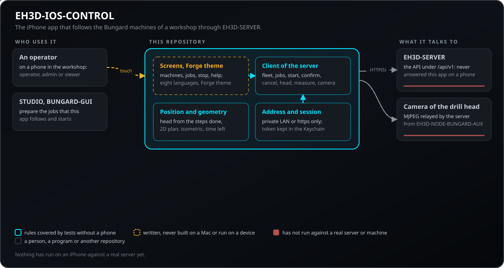
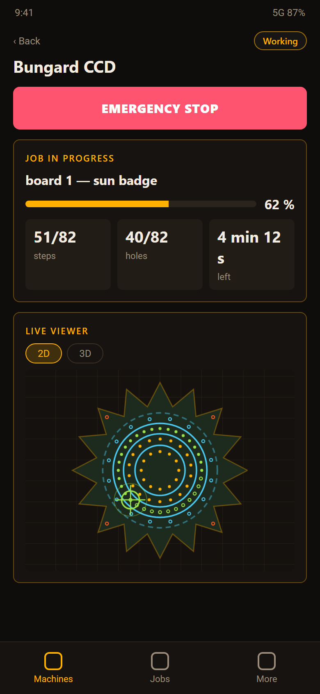
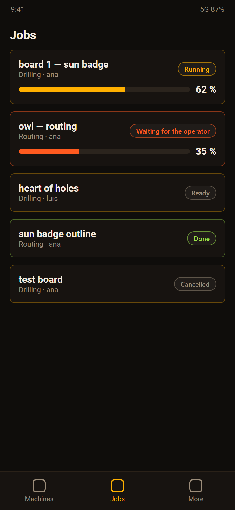
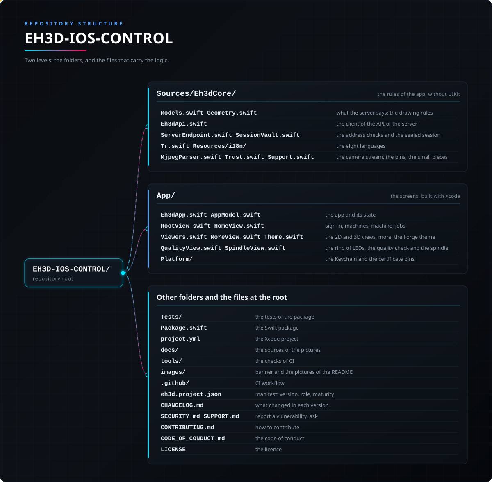

<p align="center">
  
</p>

# 🍎 EH3D-IOS-CONTROL

<p align="center"><a href="README.md">🇺🇸 English</a> | 🇪🇸 <b>Español</b> | <a href="README_fra.md">🇫🇷 Français</a> | <a href="README_ita.md">🇮🇹 Italiano</a> | <a href="README_deu.md">🇩🇪 Deutsch</a> | <a href="README_zho.md">🇨🇳 中文</a> | <a href="README_jpn.md">🇯🇵 日本語</a> | <a href="README_por.md">🇵🇹 Português</a></p>

### La app iPhone de los programas EH3D: sigue en tiempo real las máquinas Bungard del taller a través de EH3D-SERVER, las para, muestra el trabajo en 2D y 3D y la cámara del cabezal de taladrado

<p align="center">
  
  
  
  
  
</p>

---

**Comprobación de honestidad - lo que funciona hoy:** las reglas de la app (leer lo que EH3D-SERVER dice de las máquinas, los trabajos y el cabezal, la posición del cabezal a partir de los pasos hechos, la geometría 2D e isométrica, los idiomas, las comprobaciones de dirección y la conservación de la sesión) están escritas y probadas en un ordenador. Las pantallas están escritas para iPhone en el tema Forge de los programas EH3D, pero **la app no se ha ejecutado en un iPhone contra un servidor real**, la parada de emergencia nunca ha parado una máquina real y la cámara nunca ha mostrado una placa real.

---

> **Estado de seguridad:** esta app no es un sistema de seguridad y no sustituye a la parada de emergencia de la máquina. Su parada cancela el trabajo en curso a través del servidor, que detiene la máquina y apaga los motores; necesita que la red y el servidor funcionen. Solo los operarios y administradores pueden parar o arrancar; la contraseña solo se envía a una dirección de la red local o por https, y la sesión se guarda cifrada en el teléfono.


## 📋 De un vistazo

| | |
|---|---|
| Versión | `0.0.3` |
| Madurez | Andamiaje |
| Pruebas | pruebas del paquete Swift |
| Pila tecnológica | Swift, SwiftUI |
| En hardware real | Todavía no: la app no se ha ejecutado en un iPhone, contra un servidor real ni con una máquina; lo primero que hay que probar es entrar en el EH3D-SERVER del taller. |

**Ir a:** [Resumen](#-resumen) · [Arquitectura](#-arquitectura) · [Inicio rápido](#-inicio-rápido) · [Pruebas](#-pruebas) · [Estructura](#-estructura-del-repositorio) · [Relacionados](#-proyectos-relacionados)

## 🚦 Estado del proyecto

Cada línea es una parte de este repositorio y la luz dice hasta dónde llega hoy. Se escribe con lo que el repositorio puede demostrar (pruebas, compilaciones, ejecuciones), no con lo previsto.

🟢 Hecho y verificado · 🟡 Funciona, con límites conocidos · 🟠 Hecho a medias o sin verificar · 🔴 Sin hacer o sin funcionar

| Área | Estado | Qué significa aquí |
|---|---|---|
| Software | 🟠 | Las pantallas y las reglas de la app están escritas para iPhone; las reglas compilan y se prueban sin teléfono. |
| Pruebas | 🟡 | pruebas del paquete Swift: lo que dice el servidor de la flota, los trabajos y el cabezal, la posición del cabezal, la geometría 2D e isométrica, los idiomas y las comprobaciones de dirección y versión. |
| Monitorización | 🟠 | Cada máquina del taller con su estado, su trabajo, el progreso, los pasos hechos y el tiempo que queda, leído del servidor cada segundo y medio; un aviso cuando una máquina espera al operario o se detiene. Escrito, no ejecutado contra un servidor real. |
| Parada de emergencia | 🟠 | Un botón rojo que pregunta dos veces y cancela el trabajo en curso a través del servidor (una máquina o todas); la confirmación de los pasos que espera un trabajo. Solo operarios y administradores. Nunca ha parado una máquina real y no sustituye a su parada física. |
| Visor 2D y 3D | 🟠 | La placa, los agujeros (un anillo hasta taladrarlos), las trayectorias (tenues hasta cortarlas) y el cabezal, en 2D y en una vista isométrica que gira con el dedo; la posición del cabezal es una estimación a partir de los pasos hechos. Probado como geometría, nunca visto en un teléfono. |
| Cámara del cabezal | 🟠 | La cámara del cabezal de taladrado (EH3D-NODE-BUNGARD-AUX) en MJPEG a través del servidor, sus vueltas, temperatura y salida de protección, y una medida de la mesa con el láser. Escrito, nunca ejecutado con un nodo real. |
| Actualizaciones | 🟠 | Mira la última release de este proyecto en GitHub y lo dice con un enlace; una app de iPhone no puede actualizarse sola fuera de la App Store, así que la versión nueva se instala desde la release como decida la persona. |
| Uso real | 🔴 | Todavía no: la app no se ha ejecutado en un iPhone, contra un servidor real ni con una máquina; lo primero que hay que probar es entrar en el EH3D-SERVER del taller. |
| Documentación | 🟡 | README en ocho idiomas, la ayuda de la app en ocho idiomas y las notas de la API del servidor que usa. |

## 🎯 Resumen

* Cada máquina del taller con su estado, su trabajo, el progreso, los pasos hechos y el tiempo que queda, leído del servidor cada segundo y medio; un aviso cuando una máquina espera al operario o se detiene. Escrito, no ejecutado contra un servidor real.
* Un botón rojo que pregunta dos veces y cancela el trabajo en curso a través del servidor (una máquina o todas); la confirmación de los pasos que espera un trabajo. Solo operarios y administradores. Nunca ha parado una máquina real y no sustituye a su parada física.
* La placa, los agujeros (un anillo hasta taladrarlos), las trayectorias (tenues hasta cortarlas) y el cabezal, en 2D y en una vista isométrica que gira con el dedo; la posición del cabezal es una estimación a partir de los pasos hechos. Probado como geometría, nunca visto en un teléfono.
* La cámara del cabezal de taladrado (EH3D-NODE-BUNGARD-AUX) en MJPEG a través del servidor, sus vueltas, temperatura y salida de protección, y una medida de la mesa con el láser. Escrito, nunca ejecutado con un nodo real.
* Mira la última release de este proyecto en GitHub y lo dice con un enlace; una app de iPhone no puede actualizarse sola fuera de la App Store, así que la versión nueva se instala desde la release como decida la persona.

La página de una máquina también tiene el aro de LEDs del cabezal (apagado y tres niveles) y una tarjeta Verificación de calidad: pide al servidor que mire la placa con la cámara del cabezal de taladro, juzga los agujeros y los canales fresados y muestra el veredicto grande como un cartel (CORRECTO, NO CORRECTO o no se puede juzgar) con lo que se encontró, el perfil (estándar, paso fino, prototipo) y la calibración de la escala. Las primeras pantallas (la de inicio con la marca, la espera mientras se restaura la sesión y la de entrada con sus iconos, el ojo para la contraseña y la nota sobre lo que se guarda en el teléfono) siguen el aspecto de las otras apps de la suite.

La página de una máquina también muestra el husillo de la máquina (el original o el que lleva variador de frecuencia), con sus límites y la velocidad máxima a la que debe ajustarse el nodo; un administrador lo elige y elige qué hace el servidor con un trabajo que pide más (rechazarlo, o dejarlo pasar recortado al máximo del husillo). Un trabajo muestra los excesos con que se dejó pasar, las herramientas que se desactivaron para él y los agujeros o trayectos ya hechos que deja fuera. La aplicación no prepara trabajos, así que elegir taladrado, fresado o ambos y desactivar herramientas sigue siendo cosa de EH3D-STUDIO y BUNGARD-GUI.

La tarjeta del cabezal muestra también lo que dicen sus sensores: cómo fue la última lectura del láser (válida, señal débil, demasiada dispersión, fuera de rango, fallo del sensor) con la distancia, hace cuánto se tomó y el desfase con el que se calibró el láser; si los pulsos del sensor de giro son limpios o ruidosos y cuántos se descartaron como ruido; cuántos sensores de temperatura encontró el nodo en el hilo (y un aviso cuando solo adivina cuál leer); y la versión del nodo. Un nodo que no lo dice no muestra nada de esto. Los ajustes de la imagen de la cámara, la calibración del láser y la elección del sensor de temperatura se hacen en el panel del nodo: el servidor todavía no los transmite.

## 🧩 Papel en EH3D

EH3D-IOS-CONTROL es la pantalla de bolsillo del taller EH3D: solo habla con EH3D-SERVER, que ejecuta los trabajos en las máquinas (a través de EH3D-NODE-BUNGARD) y retransmite la cámara del cabezal de taladrado (EH3D-NODE-BUNGARD-AUX). Los trabajos se preparan en EH3D-STUDIO o BUNGARD-GUI; esta app los sigue, confirma los pasos que esperan y los para.

## 🏛️ Arquitectura

<p align="center">
  
</p>

Cómo encajan las partes de este repositorio: quién lo usa, qué contiene y de qué depende. La imagen se dibuja desde `docs/architecture.json` y se comprueba contra el código.

## 🖼️ Capturas de pantalla

<p align="center">
  
</p>

<p align="center"><em>Las máquinas del taller: libres, trabajando y esperando al operario, con la parada de todas.</em></p>

<p align="center">
  
</p>

<p align="center"><em>Una máquina: la parada, el trabajo en curso y la vista 2D en directo con la posición del cabezal.</em></p>

<p align="center">
  
</p>

<p align="center"><em>La vista isométrica del mismo trabajo, girada con el dedo, y sus herramientas.</em></p>

<p align="center">
  
</p>

<p align="center"><em>El cabezal de taladrado: la cámara a través del servidor, las vueltas, la temperatura, la salida de protección y la medida de la mesa.</em></p>

<p align="center">
  
</p>

<p align="center"><em>Los trabajos del servidor con sus estados.</em></p>

<p align="center">
  
</p>

<p align="center"><em>Más: la sesión, la actualización desde GitHub, el idioma y la ayuda.</em></p>

<p align="center"><em>Un dibujo de las pantallas hecho con las mismas reglas y un trabajo de ejemplo, no una captura de un teléfono: la app no se ha ejecutado en uno.</em></p>

## 🚀 Inicio rápido

Necesita un Mac con Xcode 15 o posterior (las reglas también compilan con `swift test` en Linux) y un EH3D-SERVER en la red.

```bash
swift test                                   # the rules of the app (Eh3dCore)
brew install xcodegen && xcodegen generate   # then open EH3D-IOS-CONTROL.xcodeproj
python -I tools/ci_validate.py
```

Abra la app, escriba la dirección del servidor (y el puerto 18200), pulse Conectar e inicie sesión. Un servidor sin usuarios pide el código de alta que muestra en su consola y crea el primer administrador.

## 🧪 Pruebas

`swift test` ejecuta las pruebas del paquete Eh3dCore: los lectores del JSON del servidor (flota, trabajos, cabezal, medida), la posición del cabezal y la geometría de las dos vistas, la comprobación de la dirección, la conservación cifrada de la sesión, la comparación de versiones y los idiomas (las siete tablas tienen las mismas frases y cada frase de las pantallas está en ellas). Las pantallas se compilan con Xcode y no las cubren las pruebas.

## 🏗️ Compilación y publicación

La versión vive en `eh3d.project.json` y en `project.yml`, y cada versión tiene su entrada en [CHANGELOG.md](CHANGELOG.md). La app se compila y firma con Xcode en un Mac con la cuenta de Apple del mantenedor; una release en GitHub lleva el código y, cuando se ha construido, el archivo de la app.

## 📂 Estructura del repositorio

<p align="center">
  
</p>

<details>
<summary>Versión en texto del árbol</summary>

```text
EH3D-IOS-CONTROL/
├── Sources/Eh3dCore/
│   ├── Models.swift Geometry.swift                   lo que dice el servidor; las reglas del dibujo
│   ├── Eh3dApi.swift                                 el cliente de la API del servidor
│   ├── ServerEndpoint.swift SessionVault.swift       las comprobaciones de dirección y la sesión cifrada
│   ├── Tr.swift Resources/i18n/                      los ocho idiomas
│   └── MjpegParser.swift Trust.swift Support.swift   el flujo de la cámara, los pines, las piezas pequeñas
├── App/
│   ├── Eh3dApp.swift AppModel.swift                  la app y su estado
│   ├── RootView.swift HomeView.swift                 acceso, máquinas, máquina, trabajos
│   ├── Viewers.swift MoreView.swift Theme.swift      las vistas 2D y 3D, más, el tema Forge
│   ├── QualityView.swift SpindleView.swift           el aro de LEDs, la verificación de calidad y el husillo
│   └── Platform/                                     el llavero y los pines de certificado
├── Tests/                                            las pruebas del paquete
├── Package.swift                                     el paquete de Swift
├── project.yml                                       el proyecto de Xcode
├── docs/                                             las fuentes de las imágenes
├── tools/                                            las comprobaciones de CI
├── images/                                           banner e imágenes del README
├── .github/                                          flujo de CI
├── eh3d.project.json                                 manifiesto: versión, rol, madurez
├── CHANGELOG.md                                      qué cambió en cada versión
├── SECURITY.md SUPPORT.md                            informar de una vulnerabilidad, preguntar
├── CONTRIBUTING.md                                   cómo contribuir
├── CODE_OF_CONDUCT.md                                el código de conducta
└── LICENSE                                           la licencia
```

</details>

## 🗺️ Hoja de ruta y límites conocidos

**Límites conocidos hoy**

* La app no se ha ejecutado en un iPhone, contra un servidor real ni con una máquina.
* La posición del cabezal es una estimación a partir de los pasos hechos; el servidor no informa de la posición real de la máquina.
* La parada de emergencia pasa por el servidor y la red: no es una parada física.
* La cámara nunca ha mostrado una imagen real y la medida de la mesa nunca se ha tomado con un láser real.

**Siguiente**

* Entrar en el EH3D-SERVER del taller y seguir un trabajo real.
* Mostrar la posición real del cabezal cuando el servidor la informe.
* Avisos con la app cerrada (un canal push del servidor).
* Una página para preparar y arrancar trabajos desde el teléfono.

## 🌍 Idiomas

El README y los textos existen en inglés, español, francés, italiano, alemán, chino, japonés y portugués de Portugal.

## 🔗 Proyectos relacionados

* [EH3D-SERVER](https://github.com/JuanenRac/EH3D-SERVER): el centro de la familia EH3D: ejecuta los trabajos en las máquinas y da a esta app todo lo que muestra
* [EH3D-STUDIO](https://github.com/JuanenRac/EH3D-STUDIO): las páginas donde se añaden las máquinas y se preparan los trabajos
* [EH3D-BUNGARD-GUI](https://github.com/JuanenRac/EH3D-BUNGARD-GUI): el programa del ordenador que prepara los trabajos de taladrado y fresado y los ejecuta
* [EH3D-NODE-BUNGARD-AUX](https://github.com/JuanenRac/EH3D-NODE-BUNGARD-AUX): el nodo del cabezal de taladrado: la cámara, el láser y los sensores que muestra esta app
* [EH3D-ANDROID-CONTROL](https://github.com/JuanenRac/EH3D-ANDROID-CONTROL): las apps de Android y de iPhone son gemelas: las mismas reglas y las mismas pantallas

## 📚 Documentación

* [La API del servidor](https://github.com/JuanenRac/EH3D-SERVER/blob/main/docs/API.md): lo que esta app lee y pide.
* [Registro de cambios](CHANGELOG.md)

## 🤝 Contribuir y comunidad

* Antes de un pull request ejecute `swift test` y `python -I tools/ci_validate.py`: ambos deben pasar. Vea [CONTRIBUTING.md](CONTRIBUTING.md) y el [código de conducta](CODE_OF_CONDUCT.md).
* Cada texto que muestra la app está en las tablas de `Sources/Eh3dCore/Resources/i18n` en los ocho idiomas; una prueba las mantiene completas.
* Informe de una vulnerabilidad en privado: [SECURITY.md](SECURITY.md). Preguntas, ideas e informes: electrohobby3d@gmail.com ([SUPPORT.md](SUPPORT.md)).

## 👤 AUTOR

**JuanenRac (Electro Hobby 3D)** · electrohobby3d@gmail.com

## 📜 LICENCIA

Software: GPL-3.0-or-later. Véase [LICENSE](LICENSE). Los diseños de hardware de la suite usan CERN OHL-S.
